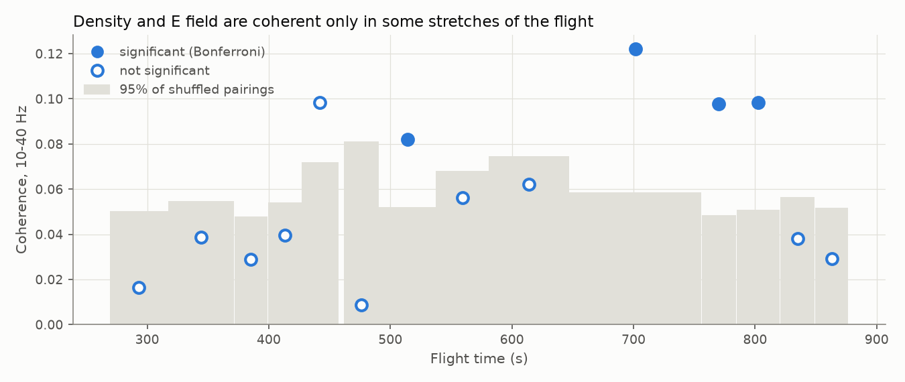
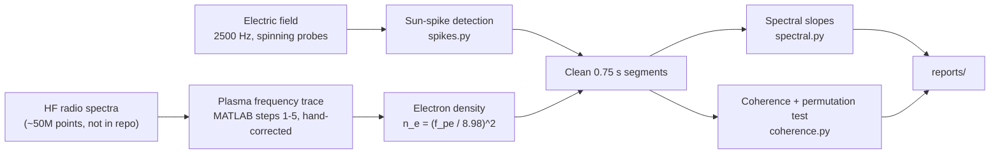
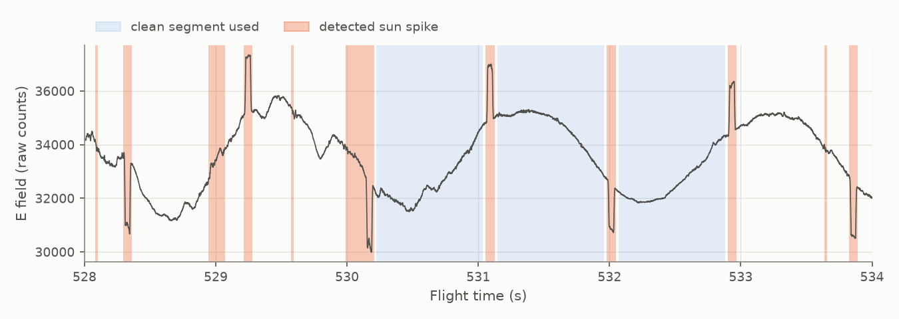

# Electron density and electric-field fluctuations in the dayside aurora

Research from my physics degree at Dartmouth (2021-2022, Prof. LaBelle's group), on data from the NASA TRICE-2 High sounding rocket. In 2026 I picked it up again with the tools I use as a data scientist: an exact Python reproduction of the original MATLAB analysis, automatic data cleaning, uncertainty estimates, and a direct statistical test of the physics.

## The question

Does the electron density in the aurora follow the **Boltzmann relation**, that is, do density fluctuations move together with fluctuations of the electric potential? Answering this from a single rocket pass means building the density time series from radio spectra first, then comparing it with the measured electric field.

## Results



- **The 2022 analysis is reproduced exactly.** The Python port recomputes all 165 MATLAB windows, with a maximum difference of 5e-7 (the rounding of the original text output).
- **Density and E field are linearly related, but only in some stretches of the flight.** The coherence in the 10-40 Hz band is small but well above chance over the whole flight (permutation test, p = 0.001). In blocks of about 28 s, it is significant in 4 of 14 blocks after a Bonferroni correction, all between about 490 s and 820 s. This puts a number on the 2022 impression that "the relation shows up only in some cases".
- **Exploratory: the coherent stretches are where wave activity is strongest.** Per block, coherence follows E-field power in 10-40 Hz (Spearman rho = 0.78), which is highest where the rocket appears to be inside the aurora. Either the coupling is stronger there, or it is only detectable when both signals are strong; a cleaner density trace could tell them apart ([section 5](reports/results.md#5-exploratory-coherence-and-signal-strength), [figure](reports/figures/coherence_vs_power.png)).
- **The spectral slopes do not show the difference we expected.** In the main period (500-815 s) the E-field slope minus the density slope is -0.15, 95% CI [-0.69, 0.36]. Our working expectation in 2022 was about +2 (see Limitations for the assumptions behind it). The difference also moves from -1.4 to +0.4 depending on the fit band, so slopes alone are a fragile test.
- **Before about 500 s, the density data cannot answer the question.** Its spectrum is flat in 10-40 Hz (slope about 0), which means the traced density is at its noise floor there. A better plasma-frequency trace is the main lever to improve the result (see Next steps).

| | 2022 (MATLAB) | 2026 (Python) |
|---|---|---|
| Clean windows | 64, chosen by eye from 11 hand-picked start times | 445 segments found automatically, whole flight |
| Sun-spike handling | Fixed 0.92 s grid, restarted by hand | Every spike detected from its sharp edges |
| Uncertainty | None | Standard errors, block-bootstrap CI, permutation tests |
| Test of the relation | Compare slopes | Slopes plus coherence (direct test) |
| Reproducibility | Interactive scripts (`input`, `ginput`) | `make all`, 11 tests |

All numbers come from [`reports/results.md`](reports/results.md), generated by `make reproduce`.

## How it works





The probes spin with the rocket (period about 1.84 s), and a sharp "sun spike" appears every half spin. The analysis uses only the stretches between spikes.

| Decision | Why (vs which alternative) |
|---|---|
| Port the MATLAB code first, quirks included, and test it number by number | Any later change can then be measured against a verified baseline (vs rewriting from scratch and hoping it matches) |
| Detect spikes from sharp jumps, and keep only 0.75-0.9 s gaps between spikes | A missed spike makes a ~1.8 s gap, which is dropped automatically, so no spike can leak into a segment (vs a fixed time grid, which drifts into the spikes) |
| Test the relation with coherence, not only slopes | Coherence measures whether the two signals move together; equal or different slopes can happen with no relation at all |
| Flip the sign of E in each segment according to the preceding spike's polarity | The probe pair turns 180° every half spin; without this, real correlation cancels out (coherence goes from 0.0040 to 0.0058) |
| Permutation tests that shuffle segment pairings | Keeps both spectra intact and makes no assumption about their distribution (vs textbook coherence thresholds, which assume independent Gaussian segments) |
| Moving-block bootstrap for the slope CI | Neighbouring windows are correlated in time; resampling single windows would give an interval that is too narrow |

## How to run

Requires [uv](https://docs.astral.sh/uv/) (it installs Python 3.12 if needed).

```bash
make all   # setup, verify data checksums, lint, tests, regenerate reports/
```

The original MATLAB scripts are in [`matlab/`](matlab/), numbered in pipeline order. Their step-by-step manual is in [`docs/pipeline.md`](docs/pipeline.md).

## Project structure

```
├── src/plasma_physics/
│   ├── io.py            # load the processed data
│   ├── legacy.py        # exact port of the 2022 MATLAB slope analysis
│   ├── spectral.py      # periodogram and log-log slope fit with standard error
│   ├── spikes.py        # sun-spike detection and clean segments
│   ├── coherence.py     # density/E-field coherence and permutation test
│   ├── stats.py         # moving-block bootstrap
│   ├── plasma_freq.py   # next step: automatic plasma-frequency tracking (outline)
│   └── report.py        # runs everything, writes reports/
├── tests/               # reproduction test + synthetic checks of every method
├── reports/             # results.md and figures (generated)
├── data/processed/      # density, E field, 2022 slopes (+ SHA256SUMS)
├── matlab/              # original 2021-2022 scripts, step01 to step07
└── docs/                # original manual, figures, handwritten lab notes
```

## Limitations and next steps

**Limitations**
- The HF spectra (about 50M points) are not in this repository, so the plasma-frequency trace, and therefore the density, cannot be rebuilt here.
- The density trace was corrected by hand point by point; its noise floor hides the 10-40 Hz band before about 500 s.
- The electric field is in raw counts from one probe pair. Without the second pair the signal cannot be despun, and the instrument's frequency response is not applied.
- The spike detector is conservative: it also flags some small jumps that are not spikes. That only discards segments (445 kept out of about 850 possible); it never lets a spike in.
- Coherence blocks are defined by segment count (30), so their duration varies (28 to 109 s).
- The +2 expected slope difference was a working value from discussions in the group, not taken from the literature. It follows from a simple argument: the Boltzmann relation gives δn/n ∝ δφ, and E = -∇φ gives |E(k)|² ∝ k²|δn(k)|², so if structures drift past the rocket unchanged (frequency ∝ k) the E-field slope is 2 higher (flatter) than the density slope. It assumes constant electron temperature, frozen-in structures, and that the probe measures E along k, which a spinning single probe pair does not guarantee. The correct expectation for this geometry still needs to be checked.
- Two MATLAB headers (`step06`, `step07`) say "TRICE2-LOW"; to the best of my knowledge the data is from TRICE-2 High, as the original manual states. To be confirmed with Prof. LaBelle.

**Next steps**
1. Rebuild the plasma-frequency trace automatically from the HF spectra (change-point score plus Viterbi tracking, outlined in [`plasma_freq.py`](src/plasma_physics/plasma_freq.py)), and validate it against the hand-corrected trace.
2. Use both probe pairs to despin the electric field, and apply the instrument response.
3. Repeat the analysis on the other flights of the campaign.

## History and credits

- Research supervised by Prof. LaBelle, Dartmouth College, 2021-2022. The repository was created at his request so that future students could continue the work.
- Chrystal Moser (Dartmouth) wrote `matlab/step01` and `step02` and made the CAPER-2 spectrogram in `docs/`.
- `docs/lab-notes.pdf` holds Prof. LaBelle's handwritten notes from 2022 on which windows to keep.

License: MIT. If you use this code or data, see [`CITATION.cff`](CITATION.cff).
